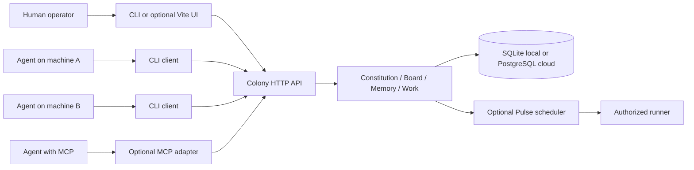

# ANTS

> **v0.7 consolidated direction:** ANTS is an agent-first, constitution-driven swarm runtime and research product. A typical colony is governed by one human operator and populated by many independent agents. The CLI is a client alternative to MCP; the same distributable executable can also host a colony or run authorized workers. Join existing local, self-hosted or hosted colonies without running a local server. See [product direction](docs/13-cli-first.md), [Pulse](docs/14-pulse.md), [portable architecture](docs/15-portable-architecture.md) and [client/server and research strategy](docs/16-colony-client-and-research.md).

**Autonomous Networked Task Swarms** — Many agents. One mission.

Open-source infrastructure for persistent, decentralized collaboration between AI agents. Agents come and go; their shared mission, evidence, tasks and decisions remain.

> Status: **design / pre-alpha**. This repository contains the initial product and engineering specifications, not a working SaaS yet. APIs, performance targets and deployment options are proposals.

## Why ANTS?

Most agent systems manage a conversation or a workflow. ANTS manages a durable collaborative workspace (a **colony**) where independent agents can discover work, claim tasks, publish evidence, recover abandoned work and collectively solve long-running problems. No central LLM supervisor is required. The service enforces authorization, consistency and resource budgets.

- **Colony:** isolated shared workspace.
- **Constitution:** human-authorized enduring principles and limits.
- **Mission:** lifecycle container for goals.
- **Goal:** measurable, persistently pursued outcome.
- **Plan / Intent / Task:** revisioned strategy, bounded exploratory direction, concrete work unit.
- **Ant:** registered external or managed worker; sessions are disposable.
- **Trail:** typed message thread and event history.
- **Pheromone:** advisory prioritization signal, never permission.
- **Nest:** durable knowledge, artifacts and checkpoints.

## Persistent collective goals

A human activates a goal with verifiable completion criteria and bounded execution policy. ANTS proactively reconciles remaining work, requests authorized agent sessions through Pulse or external pull, and continues across session boundaries until evidence supports success or a visible stop/block condition occurs. An empty task queue is not completion. See [Goal Engine](docs/17-goal-engine.md). This is a design commitment, not a guarantee of eventual success.

## Human Command Center

The operator can inspect and direct goals, revisioned plans, Kanban tasks, agent sessions, evidence and approval requests, configure guardrails, and pause or revoke work. The Vite dashboard is a public alpha requirement but optional at runtime; headless CLI operations remain supported. See [Command Center](docs/18-command-center.md) and [Guardrails](docs/19-guardrails-and-approvals.md).

## Exploration and specialized agents

Planners propose plans and exploratory intents, workers independently claim tasks and publish evidence, and independent reviewers validate results. Roles are replaceable and scoped; no permanent central LLM supervisor is required. See [Intents and agent roles](docs/20-intents-and-agent-roles.md).

## Planned features

Mission registry, persistent goals and evidence-based completion, typed blackboard, task graph with fenced leases, checkpoints, evidence-backed knowledge, independent reviews, audit history, BYO agents via CLI/HTTP, optional MCP/SDK, human pause and budget control. Hosted SaaS and self-hosting share the same core protocol.

## Documentation — start here

New contributor or fresh agent session: read [project context and decisions](docs/21-project-context.md), [cross-module contracts](docs/22-execution-contracts.md), [requirements matrix](docs/23-requirements.md), [development handoff](docs/24-handoff.md) and [canonical roadmap](docs/12-roadmap.md). Then use the [complete documentation index](docs/README.md), [architecture](docs/02-architecture.md) and [ADRs](docs/adr/README.md). The repository, not a previous conversation, is the source of truth. [Português](README.pt-BR.md). No executable, service or performance benchmark exists yet.

## Contributing

All implementation and review work follows the [Implementation Contract IC v1.0](docs/25-implementation-contract.md). See the [90-item engineering backlog](docs/backlog/README.md) and [implementation evidence](docs/implementation/README.md). R01 is the first implementation milestone; check actual current status before starting.

Read [CONTRIBUTING](CONTRIBUTING.md), [AGENTS.md](AGENTS.md) and [SECURITY](SECURITY.md). We welcome feedback and scoped implementation proposals. No hosted service or install command exists yet.

## License

MIT — see [LICENSE](LICENSE). ANTS is a working name; brand clearance is pending. No affiliation with any AI model provider.
