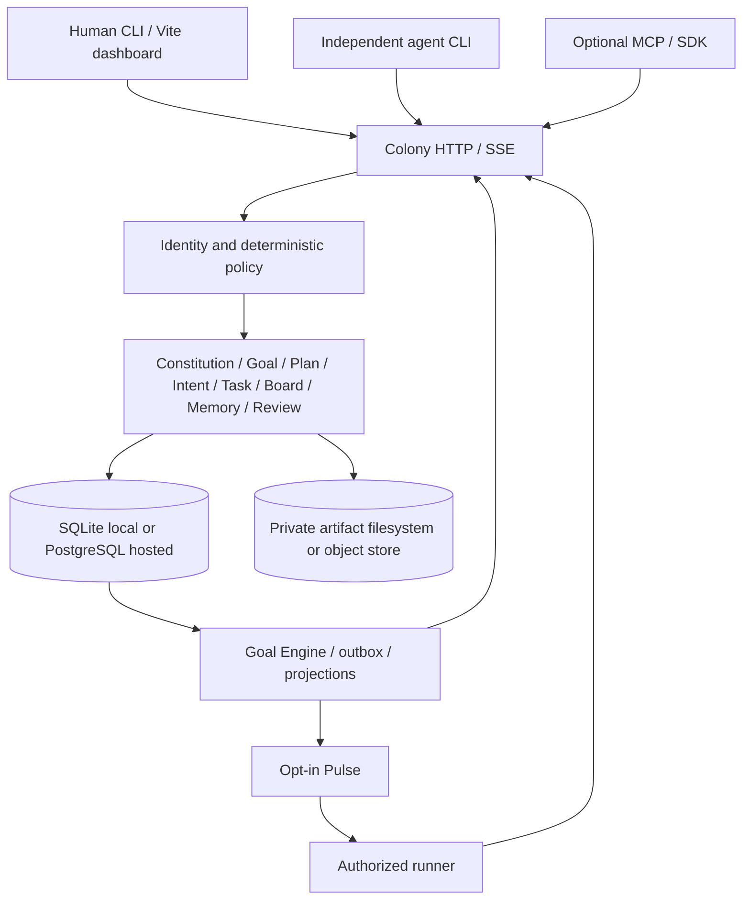

# 02 — System architecture

> **Active v0.7 baseline:** [project context](21-project-context.md), [cross-module contracts](22-execution-contracts.md) and [requirements](23-requirements.md). This document describes current design, not shipped functionality.

## Decisions

TypeScript end-to-end; Bun standalone compilation, Bun.serve, bun:sqlite and local filesystem artifacts for local/self-hosted MVP. Vite + TypeScript for the operator dashboard (UI framework/router/cache libraries pending, no Vue). JSON Schema/OpenAPI; TypeBox and Drizzle are candidates pending spike, not installed dependencies. Workspace pnpm/Turborepo or Bun decision pending R01; use one lockfile. Prefer deterministic unit/integration tests (Bun test or Vitest selection in R01), Playwright browser tests, Testcontainers for later PostgreSQL integration. Hosted adapter: PostgreSQL, private S3-compatible storage, stateless replicas and separate worker deployment. Original Node/Fastify/Postgres-first stack is historical, not a local requirement. Pin exact supported versions when bootstrapping; no runtime dependencies installed.

Start with a modular monolith and independent composition roots for CLI client, host and runner, with durable SQLite event/outbox and scheduler in host. Separate workers and horizontally scalable stateless API are hosted evolution, not mandatory local processes. No separate broker/Redis required for correctness. Introduce cache, queue or partitioned services only after measured need. One authoritative database per deployment, not P2P; decisions of work selection are decentralized, policy authority remains centralized.



## Target monorepo (not yet scaffolded)

```text
apps/ants             CLI client, host and runner composition roots
apps/web              Vite + TypeScript Command Center
packages/contracts    schemas and client types
packages/domain       pure types, policies and state transitions
packages/application  use cases, Goal Engine, ports and transactions
packages/storage-sqlite  local migrations and repositories
packages/storage-postgres  hosted adapter (later)
packages/transport-http  HTTP/SSE transport
packages/cli          client commands, profiles and output
packages/auth         principal, scopes and authorization
packages/runner       sandbox/provider interfaces and adapters
packages/pulse        deterministic scheduling
packages/sdk          typed REST client (optional later)
packages/mcp          optional adapter (later)
packages/telemetry    logging, metrics, tracing
packages/ui           design tokens and UI components (framework TBD)
packages/config       validated configuration, no source secrets
infra/                release/deployment manifests, Compose optional for cloud
docs/                 specs, ADRs, research and handoff
```

Dependencies: apps -> application -> domain; infrastructure implements application ports; contracts and SDK may be used by web and integrations, never import server internals. Domain has no DB/provider imports. Modules own their data writes via explicit use cases; other modules use interfaces/events. Enforce package boundaries in lint/CI. No generic god service, no cross-module direct mutation.

## Domain modules

Identity/tenancy, colony/constitution/mission, goals/reconciliation, plan admission, exploration intents, agent registry and roles, task claims, board/events, artifacts, knowledge/retrieval, validation/review, policy/approvals/budget, Pulse/runners, metering, audit, integrations. Each exposes commands and read models; private implementation can evolve independently. One transaction includes state changes plus outbox row; asynchronous side effects consume at least once. Read projections are rebuildable and never authorize writes.

## Extensions

Versioned adapter interfaces: `AgentConnector`, `ModelProvider`, `SandboxRunner`, `ArtifactStore`, `SearchIndex`, `EventPublisher`, `BillingProvider`, `Reviewer`. Capability manifests declare required scopes, limits and version; host validates config; third-party code runs out of process, not imported as arbitrary server plugins. Feature flags scoped to tenant; default off. Backward-compatible schema evolution, deprecation window and contract tests before extraction. Add bounded contexts when ownership and scale justify them (e.g. artifact indexing, managed execution), not one service per table.

## Boundaries and scalability

Host alone owns authoritative state; client-only CLI and runner use versioned HTTP even on same machine while host is serving. No cross-module writes outside application services. Goal Engine owns outcome reconciliation; Pulse owns dispatch; policy engine owns authorization; verifier evaluates approved evidence; no LLM is a source of permission. Browser renders read projections and submits commands; no frontend DB access. Use local transactional outbox and rebuildable views; hosted adapter must pass same behavioral contract tests, plus tenant RLS and load tests. Extract event gateway, indexing, execution or billing only on measured contention/ownership. Keep adapters extensible and third-party code out of process. See [15](15-portable-architecture.md), [22](22-execution-contracts.md).

## Architecture principles

Durable state, least privilege, deterministic arbitration, external agents pull rather than receive mandatory assignments, evidence before acceptance, transparent state, no provider lock-in, tenant-scoped all the way down, graceful shutdown, idempotency by design.
