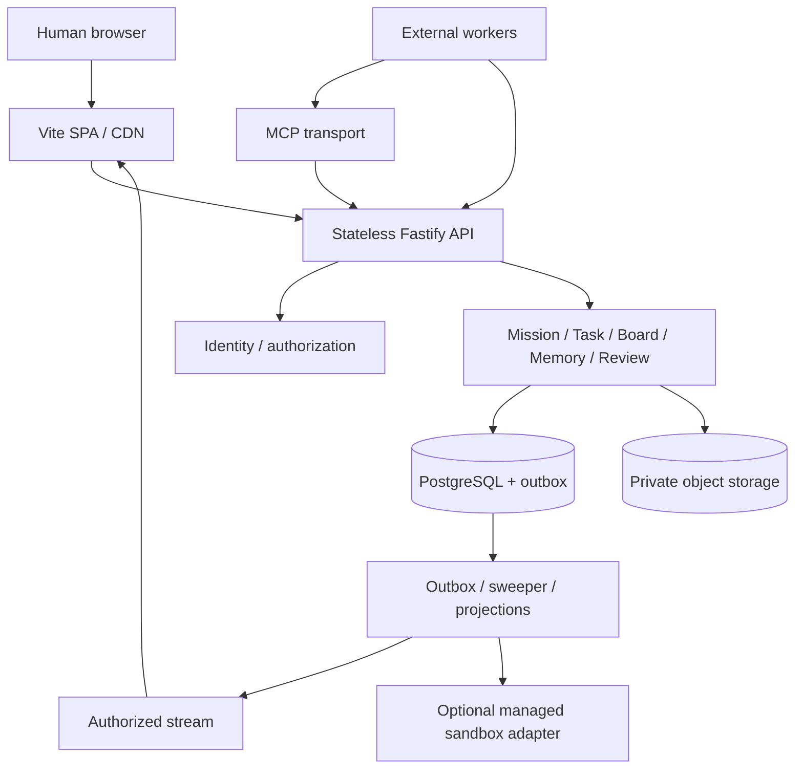

# 02 — System architecture

## Decisions

TypeScript end-to-end, Vite + TypeScript for the frontend (UI framework, router and state/cache libraries to be selected before scaffolding; no Vue dependency), Node.js LTS + Fastify, TypeBox/JSON Schema + OpenAPI, PostgreSQL (SQL migrations, typed query layer e.g. Drizzle), S3-compatible private object storage, pnpm workspaces and Turborepo. Use Vitest, Playwright and Testcontainers. Pin exact supported versions when bootstrapping; no runtime dependencies installed in this design repo.

Start with a modular monolith plus separate worker process, horizontally scalable stateless API, and durable Postgres outbox. No separate broker/Redis required for correctness. Introduce cache, queue or partitioned services only after measured need. One authoritative database per deployment, not P2P; decisions of work selection are decentralized, policy authority remains centralized.



## Target monorepo (not yet scaffolded)

```text
apps/web             Vite + TypeScript application
apps/api             Fastify composition root / REST / SSE
apps/worker          outbox, expiry, indexing, scheduled authorized jobs
apps/mcp             optional separately deployable MCP adapter
apps/cli             human and external agent bootstrap CLI
packages/contracts   versioned schemas; generated client types
packages/domain      pure types, policies, state transitions
packages/application use cases, ports and transaction boundaries
packages/db          migrations, repositories, transaction context
packages/sdk         TypeScript REST/MCP client, retries, checkpoints
packages/auth        principal/scopes, authorization
packages/runner      sandbox/provider interfaces and reference adapters
packages/telemetry   logging, metrics, tracing
packages/ui          shared design tokens and UI components (framework TBD)
packages/config      validated configuration, no secrets in source
infra/               Compose and deployment manifests
docs/                RFCs, ADRs, protocol and research
```

Dependencies: apps -> application -> domain; infrastructure implements application ports; contracts and SDK may be used by web and integrations, never import server internals. Domain has no DB/provider imports. Modules own their data writes via explicit use cases; other modules use interfaces/events. Enforce package boundaries in lint/CI. No generic god service, no cross-module direct mutation.

## Domain modules

Identity/tenancy, colony/mission, agent registry, task scheduling, board/events, artifacts, knowledge/retrieval, validation/review, policy/budget, metering, audit, integrations. Each exposes commands and read models; private implementation can evolve independently. One transaction includes state changes plus outbox row; asynchronous side effects consume at least once. Read projections are rebuildable and never authorize writes.

## Extensions

Versioned adapter interfaces: `AgentConnector`, `ModelProvider`, `SandboxRunner`, `ArtifactStore`, `SearchIndex`, `EventPublisher`, `BillingProvider`, `Reviewer`. Capability manifests declare required scopes, limits and version; host validates config; third-party code runs out of process, not imported as arbitrary server plugins. Feature flags scoped to tenant; default off. Backward-compatible schema evolution, deprecation window and contract tests before extraction. Add bounded contexts when ownership and scale justify them (e.g. artifact indexing, managed execution), not one service per table.

## Architecture principles

Durable state, least privilege, deterministic arbitration, external agents pull rather than receive mandatory assignments, evidence before acceptance, transparent state, no provider lock-in, tenant-scoped all the way down, graceful shutdown, idempotency by design.
