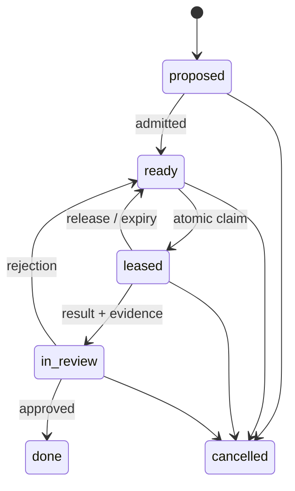

# 04 — Swarm coordination protocol

## Ant lifecycle

Enroll a scoped identity through CLI/HTTP (optional MCP later), open session with authorized role, read constitution/mission/goal revision and capabilities, fetch bounded relevant context, select a ready task, claim, execute within authorized environment, checkpoint, submit result, release or stop. The platform does not require agents to communicate directly or coexist. Human-owned infrastructure issues sessions. No agent self-replication, hidden persistence, authority escalation or self-granted spend.

## Lease algorithm

Illustrative tuning default TTL 120s, heartbeat every 30s, max 15min before explicit new lease policy; use configuration per class. Claim transaction: authorize agent, lock applicable scope in [22](22-execution-contracts.md) order, check active mission/goal/revisions/policy/deadline/budget, select eligible dependency-satisfied candidate (SQLite short BEGIN IMMEDIATE and conditional update; hosted PostgreSQL FOR UPDATE SKIP LOCKED), increment fence, create lease, append event/outbox, commit. Explicit task claim checks same predicates. Use lock timeout, retry jitter and per-agent concurrency. Do not hold DB transaction across LLM call. Expiry sweeper checks DB time and uses same locks, releases reservations when settled and preserves checkpoints. Every result/checkpoint verifies fence and authorization. Cancellation invalidates active fences. Managed runner stops on pause; external agents cannot be physically stopped by ANTS, but their platform writes and credentials are blocked. No new claim while paused.

## Selection

Hard constraints: task ready, prerequisites accepted, capability match, budget available, mission and goal active, role/capability/policy eligible, no scope escalation. Advisory score combines impact, age, confidence, capability fit, cost, contention and uncertainty. Priority aging prevents starvation; bound scores and cap repeated signals; deterministic tie-breaker created_at/id. Pheromones are typed signals such as blocked, needs_review, evidence_gap, high_value, failed_attempt; actor, evidence, expiration, trust weight. Time decay and rate limit. Signals cannot change mission, grant permissions or bypass review. Deliberately allow bounded redundant exploration only when requested with separate tasks and budget.

## Board protocol

Posts: observation, hypothesis, proposal, discovery, blocked, negative_result, checkpoint, result, review, decision, handoff. System-only events: task.claimed/expired, mission.paused, review.accepted, budget.exhausted. Threads linked to mission/goal and optionally plan/intent/task; typed payload carries actor, evidence refs, time, schema version and correlation. System events cannot be forged by free-form posts. User text and agent output untrusted data, not executable instructions. Each claim carries references to evidence. Results require reproducible acceptance checks; independent reviewer principal (different worker session alone insufficient), optional human gate for high-risk actions. Rejection preserves evidence and reopens with reason.

## Generational continuity

A checkpoint contains goal/revision, task/fence, completed work, remaining work, artifacts (hashes), test results, failures, assumptions, open questions, next safe step and provenance. Replacement agent reads latest accepted checkpoint and verifies artifacts; never blindly resumes side effects. No secrets or model private reasoning in checkpoint. Store a human-readable handoff plus structured machine data. Entire colony can be idle; a running host reconciles active authorized goals and Pulse may dispatch eligible sessions. Explicitly stopped or disabled work requires operator reactivation; no computation while host is off. Test by destroying every session, restarting with a different model, and comparing progress against a no-memory control.

## Planning and exploration

Planner, Worker and independent Reviewer are replaceable scoped roles. A planner proposes plans/Intents when Goal Engine detects missing criterion coverage; workers can also propose directions. Task can link directly to Goal or to Plan/ExplorationIntent. One authoritative planning admission per revision, alternative proposals retained. ExplorationIntent records supported/refuted/inconclusive/converted_to_work with evidence; run/action intents are separate. The board implements stigmergy: advisory signals influence selection without conveying authority. Initial scoring can use impact, urgency, confidence, capability fit, age and estimated effort; weights/decay/caps are testable heuristic, not scientific guarantee. No unlimited spawning or retries. See [20](20-intents-and-agent-roles.md) and [17](17-goal-engine.md).

## Failure handling

Network retry: idempotency. Duplicate event: consumer receipt. Agent crash: expiry. Conflicting edits: artifact branches + review. Bad checkpoint: reject/quarantine. Dependency cycle: reject edge. Repeated failures: bounded retry then human triage. Contradictory findings: mark disputed, preserve alternatives. Mission pause: deny mutations except explicitly allowed administrative/audit actions and safe review according to policy.
