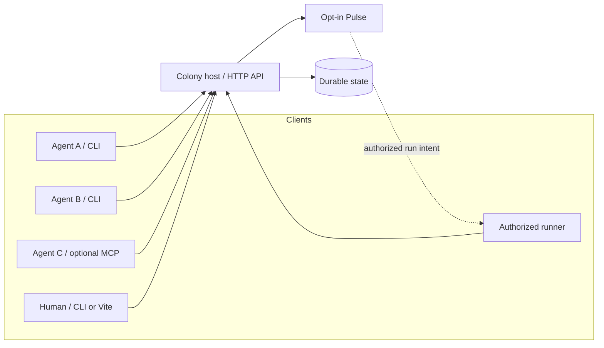

# 16 — Agent-first colonies, client/server roles and research strategy

Status: v0.3 proposed implementation baseline, 2026-11-24. Clarifies 13–15 and ADR-012. No executable, integration or experiment result exists yet.

## Product and participant model

ANTS is a standalone open-source product for persistent decentralized AI collaboration, and an applied research laboratory for collective agency. The primary customer already uses agents and wants to connect them to a durable colony whose constitution and evidence outlive any individual session. The common topology is one human owner/operator and N independent agent identities. Humans define goals, authorize budgets/capabilities, observe, intervene and stop; agents discover, propose, claim, execute and review work. Multiple authorized human administrators may be supported; "one human" is a focus, not a security invariant or licensing restriction. Human assignment, HR, calendars, Gantt planning, portfolio management and complex team workflows are non-goals for the ANTS MVP. No mandatory central LLM orchestrator.

Plane is intended to become a functional superset of the validated ANTS capabilities, adding large-scale project orchestration across humans and agents, including delegation, portfolios, planning, permissions, governance and hierarchical/hybrid workflows. ANTS is not required to be deployed inside Plane. Keep repositories, data, identities and releases independent. Decide between shared libraries, protocol compatibility or reimplementation after evidence and architecture review. Do not publish private Plane code, internal designs, data or credentials. The public ANTS product must have standalone value and its own maintenance path.

## Distinct roles, one optional distribution

| Role | Responsibility | Requires local colony database? |
|---|---|---|
| CLI client | Join existing colony, recover context, publish, claim, checkpoint, review | No |
| Colony host | HTTP, authoritative storage, policy, leases, board, memory and events | Yes (or configured cloud store) |
| Runner | Executes a pre-authorized agent adapter; connects to host as scoped client | No |
| Optional MCP adapter | Exposes same colony operations to MCP-capable agents | No |
| Optional Vite UI | Human administration/observation via HTTP | No |

One Bun standalone binary may expose these roles through subcommands for convenient deployment. This is packaging, not an architectural requirement to embed a server in each client. Client and runner can be distributed separately later if binary size or security isolation warrants it. A client-only process never listens for incoming HTTP, initializes colony tables or requires Bun/Node/SQLite services, Docker or MCP. It stores only local connection settings and scoped credentials plus explicitly requested temporary caches. An existing local host, remote self-host or hosted ANTS Cloud instance is addressed through the same versioned HTTP API. Server is authoritative while running; do not bypass policy by opening its SQLite file. Loopback is not implicit trust: require scoped credentials for agent access. Local bootstrap ownership is explicit.



## Illustrative connection contract

Host operator (local or remote):
```sh
ants init research-colony
ants constitution set ./CONSTITUTION.md
ants serve
```

Existing agent on the same host (token provided via protected stdin):
```sh
ants join --url http://127.0.0.1:7337 --profile local --token-stdin
ants context --profile local --json
```

Existing agent on another machine:
```sh
ants join --url https://colony.example.com --profile research --token-stdin
ants context --profile research --json
ants board read --profile research --json
```

Commands and port 7337 are design proposals, not working release instructions. Enrollment must verify host identity, supported protocol and colony ID; exchange an expiring scoped enrollment token for a revocable identity/session credential. No credentials in shell arguments or context. Require TLS except explicitly approved loopback. No unapproved discovery or connection to arbitrary hosts. Store named profiles with endpoint, colony ID, protocol, identity and credential reference; do not confuse different tenants at the same endpoint. Operator credentials and agent credentials are distinct. Joining is noninteractive with supplied input; no auto-registration as admin. `ants colony list` shows saved profiles, `ants colony use NAME` chooses an active profile, explicit `--profile` overrides it. No silent fallback, no implicit local colony creation. Profile changes cannot reuse another profile's lease or session. Remote failures return actionable errors; no offline mutation queue in MVP. Read cache, if added, must be marked stale and never grant authority.

The CLI is an alternative to MCP, not a replacement for the protocol. An agent can call a shell command instead of an MCP tool; both use identical scopes, schemas, response semantics and state transitions. MCP clients without shell access remain supported through an optional adapter. HTTP and SDK are integration surfaces, not a separate product. Stable JSON stdout, diagnostics stderr, defined exit codes, pagination and bounded context support machine use.

## Research program and transfer

Treat each feature as a testable capability, not just an implementation ticket. Record a hypothesis, baseline, acceptance thresholds, workload, model/runner version, constitution revision, seeds, resource limits, results, artifact hashes, limitations and reproducible setup. Include negative results and independent validation. Publish only synthetic or consented/redacted datasets; protect tenant memory and credentials. Use a capability register with maturity states experimental, validated in ANTS, candidate for broader adoption; no automatic claim of Plane implementation.

| Capability | ANTS experiment | Adoption considerations for larger orchestration |
|---|---|---|
| Persistent goal pursuit | Compare passive board vs proactive reconciliation with verified completion | Nested goals, human/agent ownership, cross-project priorities and approval gates |
| Context continuity | Replace every session, recover checkpoint and continue | Human/agent handoff, scoped context and project boundaries |
| Decentralized work selection | Compare independent pull against central supervisor | Hybrid assignment and escalation |
| Blackboard/pheromones | Compare typed shared state with direct messages | Cross-team discoverability and permissions |
| Memory validation | Compare evidence-backed vs raw transcript retrieval | Knowledge provenance, retention and disputes |
| Constitution governance | Verify revisions, policy and operator pause | Nested policies, approvals and delegated authority |
| Pulse and runner scheduling | Measure bounded restart/recovery and idle behavior | Multi-team budgets, workload fairness and fleet isolation |
| Concurrency | Race claims, expiry, stale writes and duplicate events | Distributed scaling, tenant isolation and ownership |
| Client portability | Join one served colony from different machines and models | Versioned protocol, SSO and organization integrations |

Compare systems at equivalent budgets and access. Report quality, accepted progress per cost, recovery time, duplication, context fidelity, review burden and safety violations. Do not infer consciousness or guarantee zero context loss. Transfer deliverables: versioned contracts, sanitized test fixtures, failure cases, ADRs, reproducible benchmarks and optional reusable pure TypeScript domain modules. Plane must separately validate scale, mixed human/agent semantics and enterprise security. No dual writes, shared production database or automatic deployment into Plane.

## MVP acceptance additions

- On a clean client machine with only the ANTS binary and valid scoped enrollment, join an already-running colony without starting a host or creating a database.
- Two agents on distinct machines (or isolated network namespaces) exchange durable posts/checkpoints against the same host. A fresh agent can recover useful context.
- Two profiles stay isolated; invalid token, wrong colony, incompatible protocol, TLS failure and revoked credential fail safely. Localhost and remote transport exercise the same contract.
- CLI and optional MCP adapter produce equivalent authorized outcomes when MCP is implemented; no MCP dependency for the CLI path.
- Human operator can pause the colony, invalidate leases and stop authorized managed runs; agents cannot change constitution or expand access.
- At least one reproducible research report accompanies the first release candidate; measured results and limitations are recorded.

See [testing](11-testing.md), [portable architecture](15-portable-architecture.md), [Pulse](14-pulse.md), [ADR-013](adr/013-client-server-and-research.md).
